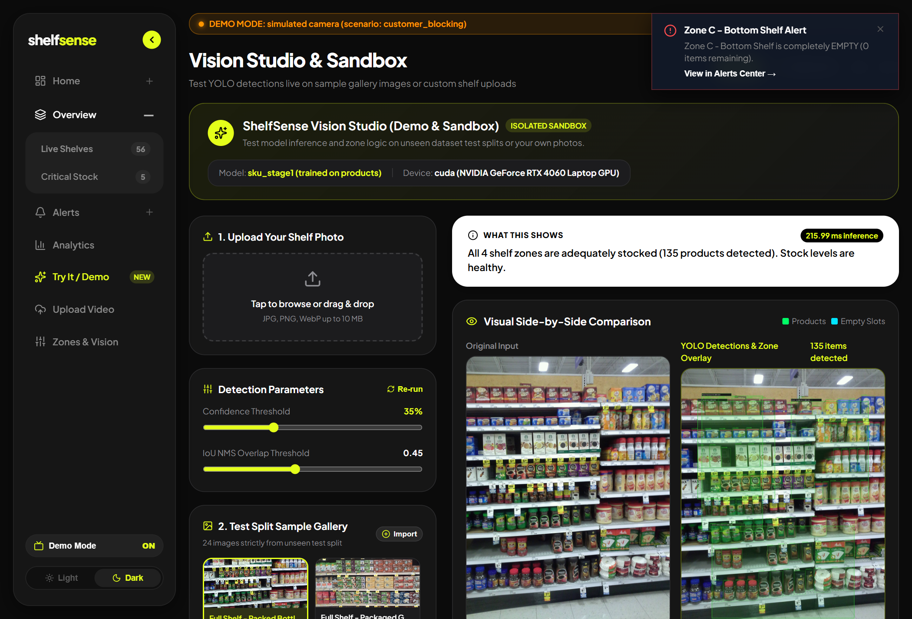
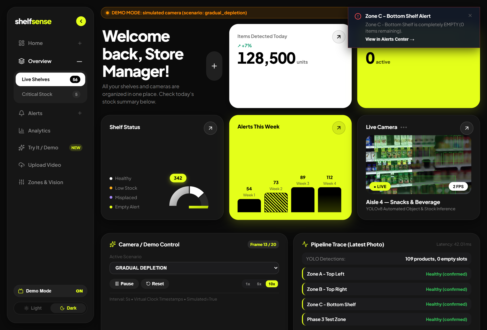
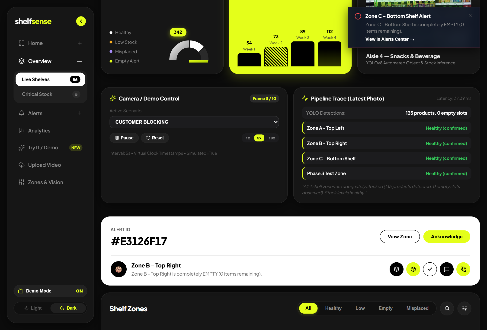

# Intelligent Empty Shelf and Low Stock Monitoring System

A full-stack computer vision system that detects empty shelf spaces, counts inventory stock in real time, flags misplaced retail products, predicts upcoming stock shortages from historical trends, and delivers live insights on a responsive PC and mobile web dashboard.

Built for **Project Phase I, Department of Computer Science & Engineering, St. Thomas College of Engineering & Technology**.

---


## 🌐 Live Cloud Deployment Guide
> 📖 **Deploying to the public internet?** Follow the complete, beginner-friendly step-by-step guide in [DEPLOYMENT.md](file:///d:/project/smart%20shelf/DEPLOYMENT.md) to launch the Frontend on **Vercel**, the Backend on **Render (Docker)**, Database on **MongoDB Atlas**, and stream local video via the **Camera Agent** for 100% free!

---

## 🏛️ System Architecture

### 1. Public Cloud Architecture (Vercel + Render + Atlas + Camera Agent)
```
 ┌────────────────────────┐
 │   Local Hardware (PC)  │
 │  • Laptop Webcam /     │
 │    ESP32-CAM stream    │
 │  • camera_agent.py     │
 └───────────┬────────────┘
             │ (POST /ingest-frame with X-API-Key)
             ▼
 ┌────────────────────────────────────────────────────────┐
 │         Render Web Service (Docker Container)          │
 │  • Gunicorn (1 worker, 4 threads)                      │
 │  • YOLOv8 Inference (CPU PyTorch, max 640px)           │
 │  • Zone Evaluation, Predictions, Alert Engine          │
 │  • REST API & Admin Authentication (/login)            │
 └───────────┬────────────────────────────────┬───────────┘
             │                                │
             ▼                                ▼
 ┌───────────────────────┐        ┌───────────────────────┐
 │   MongoDB Atlas (M0)  │        │     Vercel (PWA)      │
 │  • zones, alerts,     │        │  • React (Vite) App   │
 │    history, jobs      │        │  • Mobile Bottom Nav  │
 └───────────────────────┘        │  • Admin Login Screen │
                                  └───────────────────────┘
```

### 2. Local Architecture (Stand-alone PC)
```
                       ┌────────────────────────────────────────────────────────┐
                       │               Pluggable Video Source Layer             │
                       │   1. Laptop Webcam (cv2.VideoCapture(0))               │
                       │   2. Looped Video File (sample_shelf.mp4)              │
                       │   3. ESP32-CAM HTTP/MJPEG Stream (http://<ip>:81/stream)│
                       │   4. Remote Camera Agent (POST /ingest-frame)          │
                       └──────────────────────────┬─────────────────────────────┘
                                                  │
                                                  ▼
                                      Flask Backend (Python 3.10+)
                 ┌──────────────────────────────────────────────────────────────────┐
                 │ • YOLOv8 Object Detection (Normalized [x1, y1, x2, y2] boxes)    │
                 │ • Shelf Zone Stock Counter & Occupancy Fallback Logic            │
                 │ • Misplaced Product Detector (Expected Class vs Detected Class)  │
                 │ • Shortage Predictor (Linear Regression: Time-to-Empty / Low)    │
                 │ • Alert Engine with Cooldown Deduplication                       │
                 │ • Background Video Job Worker (FFmpeg H.264 Transcoder)          │
                 │ • JWT Dashboard Authentication & Rate Limiting                   │
                 └────────────────┬────────────────────────────────┬────────────────┘
                                  │                                │
                                  ▼                                ▼
                     MongoDB (Local Service)              React Vite Dashboard
               ┌──────────────────────────────────┐   ┌────────────────────────────────┐
               │ • zones (Configured boundaries)  │   │ • Live Annotated Video Feed    │
               │ • alerts (Anomaly history)       │   │ • Real-time Zone Capacity Cards│
               │ • history (Time-series logs)     │   │ • Recharts Trend Analytics     │
               │ • In-Memory / JSON Fallback Mode │   │ • Video Upload & Timeline Player│
               └──────────────────────────────────┘   │ • Zones & Video Source Settings│
                                                      │ • Mobile Bottom Nav & PWA Shell│
                                                      └────────────────────────────────┘
```

> **Key Architectural Decisions:**
> 1. **No Raspberry Pi**: All computer vision processing (YOLOv8 inference, stock logic, API, database) runs on the host PC or cloud container.
> 2. **Pluggable Video & Camera Agent**: Supports laptop webcams, looped disk videos, HTTP streams, and push ingest from remote camera agents with zero code changes.
> 3. **MongoDB Resilience**: If local MongoDB is unavailable or stopped, the backend automatically fails over to an in-memory/JSON store (`data/fallback_store.json`), allowing offline execution without crashing.

---

## 🚀 Quick Start Guide (Windows)

### Prerequisites
- **Python 3.10+** (tested on Python 3.14)
- **Node.js LTS (v18+)** & npm
- **MongoDB** (Local Windows service or MongoDB Community Server)
- **FFmpeg** (Local binary auto-detected in `d:\project\ffmpeg\`)

### 1. Installation
Clone the repository and run the automated setup script:
```cmd
scripts\setup.bat
```
*This will create the Python virtual environment (`venv`), install all backend dependencies, and run `npm install` for the React dashboard.*

### 2. Running Both Servers Concurrently
Double click or run:
```cmd
scripts\run_all.bat
```
This automatically launches:
- **Backend API Server**: `http://localhost:5000`
- **React Frontend Dashboard**: `http://localhost:5173`

*(Individual batch scripts `run_backend.bat` and `run_frontend.bat` are also available in `scripts/`).*

---

## 📱 Mobile Access Over Local WiFi

The system is configured out of the box for responsive mobile access on the same local network:

1. **Find your PC's Local IP Address**:
   Open PowerShell and run:
   ```powershell
   ipconfig
   ```
   Look for the **IPv4 Address** under your active Wi-Fi adapter (e.g. `192.168.1.15`).

2. **Allow Ports Through Windows Defender Firewall**:
   Run PowerShell as Administrator:
   ```powershell
   New-NetFirewallRule -DisplayName "SmartShelf Backend 5000" -Direction Inbound -LocalPort 5000 -Protocol TCP -Action Allow
   New-NetFirewallRule -DisplayName "SmartShelf Frontend 5173" -Direction Inbound -LocalPort 5173 -Protocol TCP -Action Allow
   ```

3. **Open from Your Mobile Phone**:
   Open Chrome or Safari on your phone and browse to:
   ```
   http://192.168.1.15:5173
   ```
   - The frontend automatically routes API requests to `http://192.168.1.15:5000`.
   - The dashboard automatically adapts to a mobile-first viewport with a bottom navigation bar.
   - You can tap **"Add to Home Screen"** to install it as a standalone PWA.

---

## 📸 System Screenshots & Interface Showcase

| Vision Studio & Sandbox (`/demo`) | Bento Grid in DEMO MODE (`/`) |
|---|---|
|  |  |
| *Side-by-side detection on 24 test samples with real-time confidence slider, GPU latency, and caption.* | *Real-time Bento Grid displaying simulated camera warning pill, Low alert toast, half-donut chart, and live stream.* |

| Pipeline Trace & 3-Photo Filter | Customer Occlusion Handling |
|---|---|
|  |  |
| *Real-time pipeline inspection showing 3-frame confirmation counter ("Low seen 2 of 3") and alert banner.* | *Customer reaching into shelf occludes items: 3-photo confirmation prevents false alarm.* |

---

## 📷 Unified Camera Abstraction Layer (`backend/camera/`)

ShelfSense includes a pluggable camera abstraction layer ([`backend/camera/`](file:///d:/project/smart%20shelf/backend/camera/)) providing a unified `get_photo()` interface for both virtual demonstrations and physical IoT cameras:

| `CAMERA_MODE` | Description | Typical Use Case | Configuration Keys |
|---|---|---|---|
| `simulated` *(Default)* | Replays synthetic/recorded scenario sequences at 5.0s virtual intervals with full time-scaling. | Class demos, automated testing, development without hardware | `CAMERA_SCENARIO=gradual_depletion`<br>`CAMERA_PLAYBACK_SPEED=1.0` |
| `esp32_pull` | Backend periodically polls the ESP32-CAM web server endpoint over local Wi-Fi. | Standalone shelf camera mounted on retail aisle | `ESP32_CAM_URL=http://192.168.1.100/capture`<br>`CAMERA_POLL_INTERVAL=5.0` |
| `esp32_push` | ESP32-CAM actively pushes JPEG frames to backend HTTP endpoint via `POST /ingest-photo`. | Power-saving sleep cycles or firewall-restricted networks | `CAMERA_AUTH_TOKEN=secret_key` |
| `video_file` | Reads looped video files from local disk via OpenCV `VideoCapture`. | Recorded retail shelf CCTV analysis | `VIDEO_FILE_PATH=sample_data/sample_shelf.mp4` |

### Built-in Simulated Scenarios
When running in `simulated` mode, the system includes 4 pre-configured scenarios located in `backend/demo_scenarios/`:
1. `gradual_depletion`: Shelf items deplete step-by-step from 100% down to 0% (Empty).
2. `customer_blocking`: Customer reaches in to inspect an item, temporarily occluding the shelf; demonstrates how the **3-photo confirmation filter** silences transient false alarms.
3. `restocking`: An empty shelf receives fresh inventory, resetting depletion velocity.
4. `misplaced_item`: An unexpected product category is detected inside a designated zone.

You can dynamically switch scenarios and camera modes from the dashboard **Zones & Sources** tab, or via REST API:
```bash
# Switch to ESP32 pull mode
curl -X POST http://localhost:5000/camera/mode -H "Content-Type: application/json" -d '{"mode": "esp32_pull", "url": "http://192.168.1.100/capture"}'

# Control simulated playback speed (1.0x to 100.0x)
curl -X POST http://localhost:5000/camera/simulated/control -H "Content-Type: application/json" -d '{"action": "set_speed", "speed": 2.0}'
```

### 🛡️ 3-Photo Consecutive Confirmation Filter
To prevent customer arm reach-ins or momentary shadows from triggering false alarms, alerts are gated behind a 3-photo confirmation filter:
- When a zone drops below threshold or empties, the state counter increments (`1 of 3`).
- If normal stock resumes on the next frame, the counter instantly resets with zero alert dispatched.
- Only when an anomaly persists for **3 consecutive photos** (~15 seconds) is a persistent alert published to the dashboard.

---

## 🧪 Interactive Vision Studio & Demo Mode (`/demo`)

The dashboard features a dedicated **Vision Studio** page (`http://localhost:5173/demo`) designed for examiners and classroom presentations:
- **24 Real Retail Test Samples**: Curated from the unseen SKU-110K test split in [`backend/demo_samples/`](file:///d:/project/smart%20shelf/backend/demo_samples/).
- **Side-by-Side Comparison**: Live canvas showing original raw capture side-by-side with YOLOv8 bounding boxes, class labels, and confidence tags.
- **Dynamic Threshold Slider**: Interactive confidence slider (`0.10` to `0.90`) to observe true precision-recall tradeoffs in real time.
- **Complete Test Isolation**: Analysis requests are routed through `POST /analyze-image` without polluting live production telemetry or triggering store alerts.

---

## ⚡ Inference Performance & Benchmark

Real-time YOLO inference performance was rigorously benchmarked across 20 unseen test images on the host workstation. See the full report in [`docs/performance.md`](file:///d:/project/smart%20shelf/docs/performance.md).

- **Hardware**: NVIDIA GeForce RTX 4060 Laptop GPU (8GB GDDR6, CUDA 12.6, PyTorch 2.14.1+cu126)
- **Mean Inference Latency**: **84.68 ms** (~11.8 FPS)
- **Median Inference Latency**: **83.65 ms**
- **Min / Max Latency**: **31.92 ms** / **125.65 ms**
- **VRAM Utilization**: **42.5 MB**
- **Duty Cycle**: Inference occupies only **1.69%** of the 5.0-second camera capture window, leaving 98.3% GPU headroom for concurrent camera streams.

---

## 📹 Running the Standalone Camera Agent (for Cloud Deployment)

When deploying the backend to the cloud (Render), the backend cannot access your local USB camera or home Wi-Fi ESP32-CAM. The **Camera Agent** runs on your PC next to the camera, captures frames, compresses them, and pushes them to your cloud backend via `POST /ingest-frame`:

1. Configure [`agent/.env`](file:///d:/project/smart%20shelf/agent/.env):
   ```ini
   BACKEND_URL=https://your-backend.onrender.com
   AGENT_API_KEY=shelf_agent_secret_key_2026
   SOURCE_TYPE=video
   SOURCE_VALUE=../backend/sample_data/sample_shelf.mp4
   INTERVAL_SECONDS=1.5
   ```
2. Launch the agent:
   ```cmd
   scripts\run_agent.bat
   ```
3. The live feed, inventory counts, and anomaly alerts will instantly appear on your public Vercel web app!

---

## ⚡ Alternative: Exposing PC-Hosted Backend via Cloudflare Tunnel

If you prefer to run the YOLOv8 model directly on your PC's CPU/GPU (for higher FPS than Render's free tier) while still having a public HTTPS URL:

1. Install Cloudflare Tunnel on Windows:
   ```powershell
   winget install --id Cloudflare.cloudflared
   ```
2. Start the local backend (`scripts\run_backend.bat`).
3. In a new PowerShell window, expose port 5000:
   ```powershell
   cloudflared tunnel --url http://localhost:5000
   ```
4. Copy the temporary HTTPS URL provided by Cloudflare (e.g. `https://xxxx.trycloudflare.com`).
5. In your Vercel project settings, set `VITE_API_URL` to that Cloudflare URL.
> **Tradeoff:** Fast native PC performance, but only works while your PC is awake and connected to the internet.

---

## 📦 Download Data and Model (For Teammates)

Large training datasets, video archives, and heavy model weights (> 100 MB or multi-GB) are deliberately excluded from this Git repository to keep cloning instant and within GitHub quotas. Follow these instructions to set them up locally:

### 1. SKU-110K Retail Dataset (Stage 1 Training)
* **Automatic Download**: Ultralytics can download the official 11.4 GB SKU-110K dataset automatically:
  ```powershell
  & "d:\project\venv\Scripts\python.exe" -c "from ultralytics import YOLO; YOLO('yolov8s.pt').train(data='SKU-110K.yaml', epochs=1)"
  ```
  *(Cancel after download completes, or download manually to `datasets/SKU-110K`)*.
* **Curating the Balanced Subset**:
  To generate the clean 1,800-image subset used for Stage 1 training, run our curation script:
  ```powershell
  & "d:\project\venv\Scripts\python.exe" scripts/create_sku_subset.py
  ```
  This creates `dataset_sku_subset/` with 1,500 training images and 300 validation images without dataset starvation.

### 2. Custom Labeled Shelf Dataset (Stage 2 Fine-Tuning)
* **Download Link**: `<add Roboflow or Google Drive link here>`
* **Destination**: Extract the dataset into the `dataset/` folder at project root:
  - `dataset/images/train/`, `dataset/images/val/`
  - `dataset/labels/train/`, `dataset/labels/val/`
  - Ensure labels use class `0: product` and class `1: empty_slot` (see [`dataset/LABELING_GUIDE.md`](file:///d:/project/smart%20shelf/dataset/LABELING_GUIDE.md)).

### 3. Trained Model Weights
* **Download Link**: `<add GitHub Release or Google Drive link for best.pt / shelf_v1.pt>`
* **Placement**: Place the downloaded file into `backend/models/`:
  - E.g. `backend/models/shelf_v1.pt` (or `backend/models/sku_stage1.pt` for Stage 1).
* **Configuration**: Set the path in `backend/.env`:
  ```ini
  MODEL_PATH=models/shelf_v1.pt
  ```

### 4. Expected Folder Structure After Downloading
```
smart-shelf-monitor/
├── backend/
│   └── models/
│       ├── .gitkeep
│       ├── yolov8n.pt              # Base pre-trained model (included in repo or downloaded)
│       └── shelf_v1.pt             # Trained weights (downloaded from Releases/Drive)
├── dataset/                        # Custom labeled shelf dataset
│   ├── data.yaml
│   ├── images/ (train/, val/)
│   └── labels/ (train/, val/)
├── dataset_sku_subset/             # 1,800-image SKU-110K subset (generated via script)
│   ├── data.yaml
│   ├── images/ (train/, val/)
│   └── labels/ (train/, val/)
└── datasets/                       # Full raw public SKU-110K dataset (~13 GB)
    └── SKU-110K/
```

---

## 🧠 Custom Trained YOLOv8 Model Deployment

1. **Annotate Shelf Images**:
   Follow [`dataset/LABELING_GUIDE.md`](file:///d:/project/smart%20shelf/dataset/LABELING_GUIDE.md) using Roboflow or LabelImg.
2. **Train the Model**:
   ```powershell
   & "d:\project\venv\Scripts\python.exe" train.py --epochs 50 --batch 16 --device cpu
   ```
3. **Deploy**:
   The script automatically copies the best weights to `backend/models/best.pt`.
4. Update [`backend/.env`](file:///d:/project/smart%20shelf/backend/.env):
   ```ini
   MODEL_PATH=models/best.pt
   ```
5. Restart the backend. The monitoring pipeline will immediately load your custom weights.

---

## 🔌 API Reference

| Endpoint | Method | Description |
|---|---|---|
| `/health` | `GET` | System uptime, database status, active video source, and config |
| `/shelf-status` | `GET` | Real-time zone evaluations, item counts, stock %, and depletion predictions |
| `/live-frame` | `GET` | Single JPEG frame snapshot from active video feed |
| `/live-stream` | `GET` | Continuous multipart/x-mixed-replace MJPEG feed for HTML `` tags |
| `/alerts` | `GET` | List alerts (supports `?unacknowledged=true` and `?limit=50`) |
| `/alerts/<id>/ack` | `POST` | Acknowledge a specific alert by ID |
| `/zones` | `GET` | Retrieve all configured shelf zones |
| `/zones` | `POST` | Create a new shelf zone definition |
| `/zones/<id>` | `PUT` | Update zone name, class, capacity, thresholds, or coordinates |
| `/zones/<id>` | `DELETE` | Delete a shelf zone |
| `/source` | `GET` | Retrieve active video source configuration and health metrics |
| `/source` | `POST` | Dynamically switch video source (`webcam`, `video`, `stream`) |
| `/upload-video` | `POST` | Upload MP4/AVI/MOV file to trigger asynchronous background analysis |
| `/job-status/<id>` | `GET` | Check processing status (`queued`, `processing`, `done`, `failed`) and progress % |
| `/job-result/<id>` | `GET` | Retrieve analyzed sample count, anomaly timeline events, and output video URL |
| `/outputs/<file>` | `GET` | Download/stream browser-playable H.264 annotated video |
| `/history` | `GET` | Query historical time series points for Recharts (`?zone=&hours=`) |
| `/metrics` | `GET` | Average inference latency, FPS, uptime, alert counts, and processed frames |

---

## 🧪 Automated Testing

Run the complete 26-test unit and regression test suite:
```powershell
& "d:\project\venv\Scripts\python.exe" -m pytest -v "backend/tests"
```

Run the live end-to-end integration test (requires backend running):
```powershell
& "d:\project\venv\Scripts\python.exe" "backend/tests/test_e2e_live.py"
```

---

## 📁 Repository Structure

```
smart-shelf-monitor/
├── backend/
│   ├── app.py                  # Flask REST API and streaming routes
│   ├── config.py               # Environment configuration loader
│   ├── db.py                   # MongoDB driver with in-memory JSON fallback
│   ├── sources.py              # Pluggable video sources (webcam, file, MJPEG stream)
│   ├── pipeline.py             # Live background thread (detect -> zones -> alerts)
│   ├── video_jobs.py           # Video upload processor & FFmpeg H.264 transcoder
│   ├── inference/
│   │   ├── detect.py           # YOLOv8 inference wrapper with normalized coordinates
│   │   ├── stock.py            # Zone occupancy, stock % and misplaced item logic
│   │   └── predict.py          # Linear regression depletion & shortage forecasting
│   ├── models/                 # Model weights (yolov8n.pt, best.pt)
│   ├── sample_data/            # Synthetic retail shelf demo video
│   ├── uploads/                # User uploaded video files
│   ├── outputs/                # Annotated output videos
│   ├── tests/                  # Pytest unit & live integration test suites
│   ├── requirements.txt
│   └── .env.example
├── dashboard/                  # React.js (Vite) Frontend Application
│   ├── src/
│   │   ├── components/         # Sidebar, BottomNav, Header
│   │   ├── pages/              # LiveDashboard, AlertsView, Analytics, VideoUpload, Zones
│   │   ├── services/           # Axios API client with dynamic host detection
│   │   ├── App.jsx             # Main routing and toast notifications
│   │   └── index.css           # Glassmorphic responsive design system
│   ├── public/                 # PWA manifest.json and sw.js
│   └── vite.config.js          # Host 0.0.0.0 network configuration
├── dataset/
│   ├── dataset.yaml            # YOLOv8 class definitions
│   └── LABELING_GUIDE.md       # Roboflow / LabelImg annotation instructions
├── scripts/
│   ├── run_all.bat             # Starts backend + frontend concurrently
│   ├── run_backend.bat         # Starts Flask API server
│   ├── run_frontend.bat        # Starts Vite dev server with --host
│   └── setup.bat               # Installs all Python and Node dependencies
├── train.py                    # Transfer learning helper for custom YOLO training
├── PROGRESS.md                 # Live project status and resume instructions
├── AGENT_RULES.md              # Session continuity guidelines
└── README.md
```

---

## 📜 License
Free and open-source for educational and academic use.
